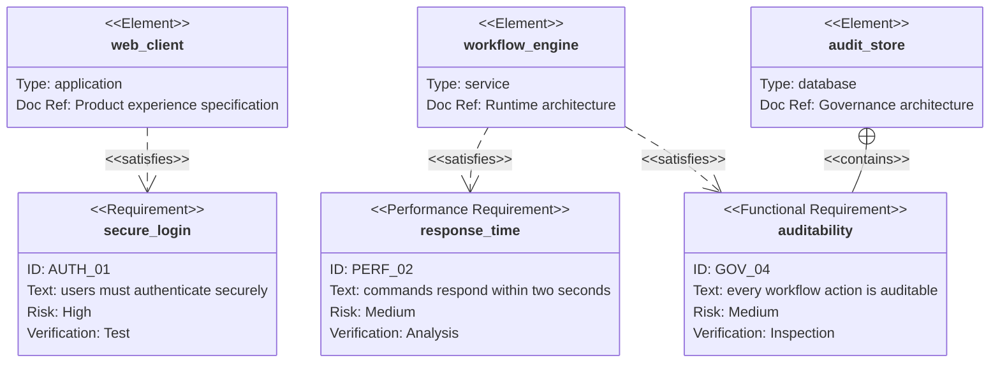

## Requirement diagram: obligations and evidence

**Atlas example 20 of 44**

Use a requirement diagram to connect requirements, system elements, risk, and verification methods.

### Core Mermaid elements
- requirementDiagram starts the model.
- requirement, functionalRequirement, and performanceRequirement declare requirement types.
- id, text, risk, and verifymethod describe each requirement.
- element declares an implementation artifact; satisfies and contains express traceability.

### Build it well
1. Give every requirement a stable id.
2. Write testable requirement text.
3. Choose verification methods deliberately.
4. Connect each requirement to the elements that satisfy or contain it.

> A requirement without verification or ownership is only a wish.

<!-- ds-course-column:2 type=markdown -->

## Working example

Use the chart controls to zoom, fit, open fullscreen, or inspect the exact source.
