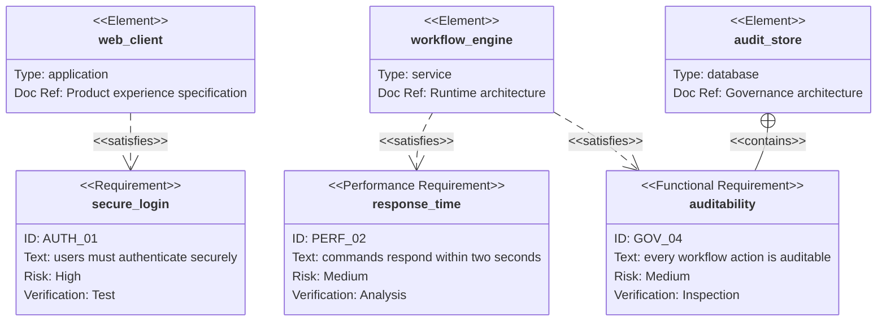

## Mermaid source

```text
requirementDiagram
  requirement secure_login {
    id: AUTH_01
    text: users must authenticate securely
    risk: high
    verifymethod: test
  }
  functionalRequirement auditability {
    id: GOV_04
    text: every workflow action is auditable
    risk: medium
    verifymethod: inspection
  }
  performanceRequirement response_time {
    id: PERF_02
    text: commands respond within two seconds
    risk: medium
    verifymethod: analysis
  }
  element web_client {
    type: application
    docref: Product experience specification
  }
  element workflow_engine {
    type: service
    docref: Runtime architecture
  }
  element audit_store {
    type: database
    docref: Governance architecture
  }
  web_client - satisfies -> secure_login
  workflow_engine - satisfies -> response_time
  workflow_engine - satisfies -> auditability
  audit_store - contains -> auditability
```

Change one line at a time, then compare the rendered result on the right.

<!-- ds-course-column:2 type=markdown -->

## Rendered result



Use zoom, fit, fullscreen, and source controls when the diagram is dense.
