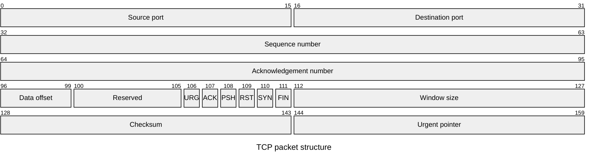

## Packet diagram: bit-level layouts

**Atlas example 21 of 44**

Use a packet diagram to explain protocol headers and the exact bit ranges occupied by each field.

### Core Mermaid elements
- packet-beta starts the layout; title names the structure.
- 0-15: "Field" assigns an inclusive bit range.
- A single bit uses one number such as 106.
- Fields are rendered in order across fixed-width rows.

### Build it well
1. Keep ranges ordered and non-overlapping.
2. Use the protocol’s real bit numbering.
3. Name flags individually when they matter.
4. Check that the final range matches the expected packet size.

> Packet diagrams are ideal for binary structure, not general data models.

<!-- ds-course-column:2 type=markdown -->

## Working example

Use the chart controls to zoom, fit, open fullscreen, or inspect the exact source.
