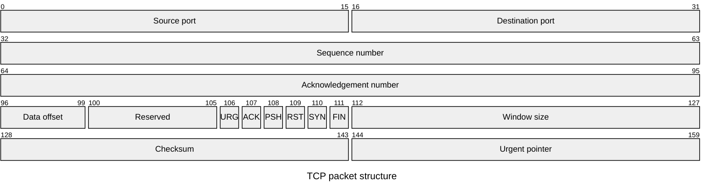

## Mermaid source

```text
packet-beta
  title TCP packet structure
  0-15: "Source port"
  16-31: "Destination port"
  32-63: "Sequence number"
  64-95: "Acknowledgement number"
  96-99: "Data offset"
  100-105: "Reserved"
  106: "URG"
  107: "ACK"
  108: "PSH"
  109: "RST"
  110: "SYN"
  111: "FIN"
  112-127: "Window size"
  128-143: "Checksum"
  144-159: "Urgent pointer"
```

Change one line at a time, then compare the rendered result on the right.

<!-- ds-course-column:2 type=markdown -->

## Rendered result



Use zoom, fit, fullscreen, and source controls when the diagram is dense.
