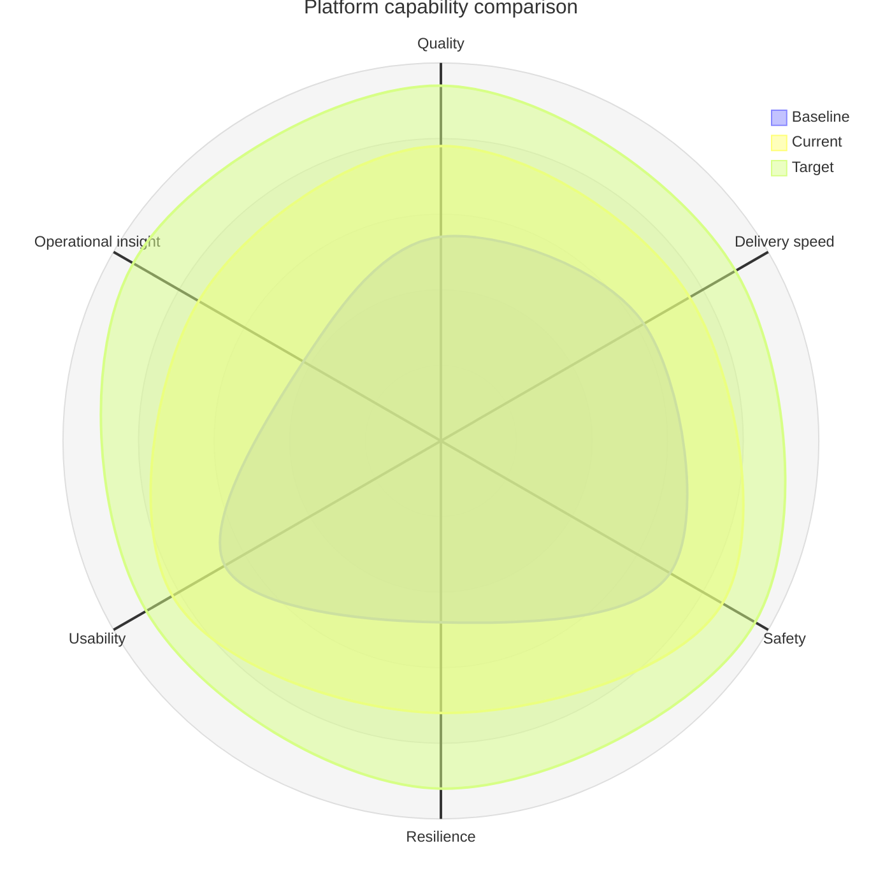

## Radar chart: multi-dimensional profiles

**Atlas example 22 of 44**

Use a radar chart to compare several profiles across the same capability dimensions.

### Core Mermaid elements
- radar-beta starts the chart.
- axis id["Label"] declares each dimension.
- curve id["Label"]{values} supplies one value per axis.
- max and min define a common scale.

### Build it well
1. Use the same scale and meaning for every axis.
2. Keep the number of axes readable.
3. Ensure every curve has exactly one value per axis.
4. Use tables when precise values matter more than profile shape.

> Radar charts reveal balance and gaps, but they can hide small numeric differences.

<!-- ds-course-column:2 type=markdown -->

## Working example

Use the chart controls to zoom, fit, open fullscreen, or inspect the exact source.
