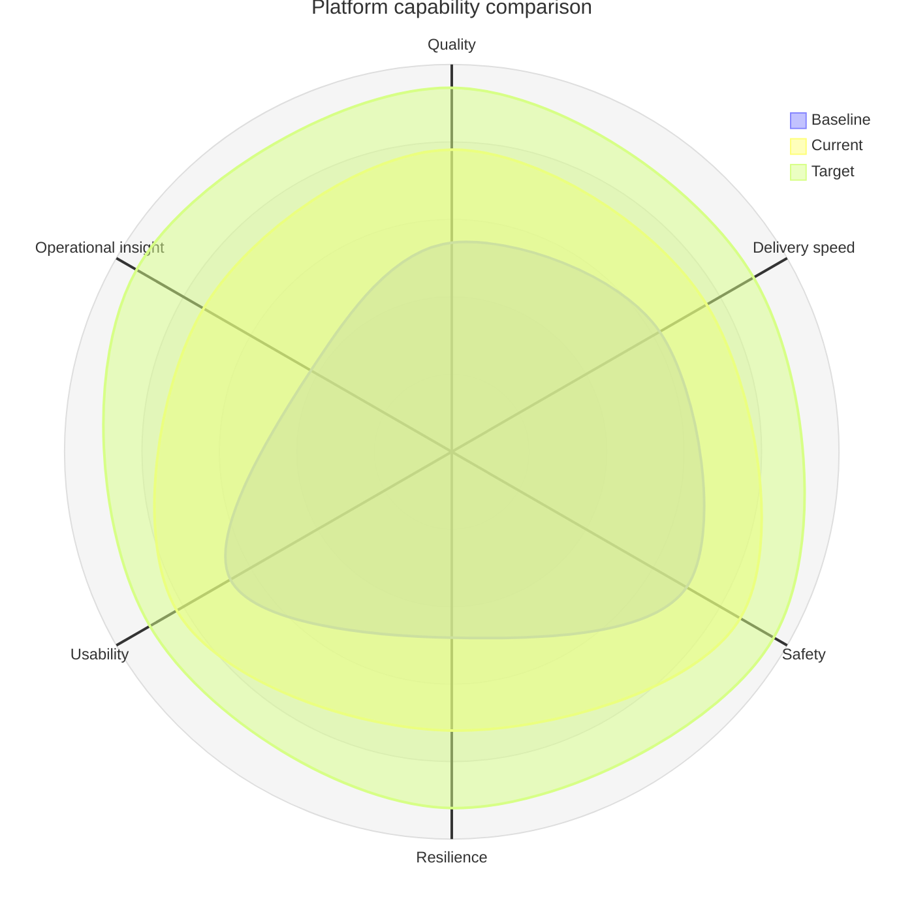

## Mermaid source

```text
radar-beta
  title Platform capability comparison
  axis quality["Quality"], speed["Delivery speed"], safety["Safety"], resilience["Resilience"], usability["Usability"], insight["Operational insight"]
  curve baseline["Baseline"]{54, 62, 70, 48, 66, 42}
  curve current["Current"]{78, 76, 86, 72, 82, 74}
  curve target["Target"]{94, 90, 96, 92, 90, 94}
  max 100
  min 0
```

Change one line at a time, then compare the rendered result on the right.

<!-- ds-course-column:2 type=markdown -->

## Rendered result



Use zoom, fit, fullscreen, and source controls when the diagram is dense.
