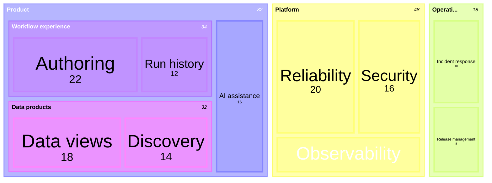

## Treemap: hierarchical composition

**Atlas example 23 of 44**

Use a treemap to show how a total is distributed across nested categories.

### Core Mermaid elements
- treemap-beta starts the chart.
- Quoted labels create groups and leaves.
- Indentation creates the hierarchy.
- A leaf followed by : value controls its area.

### Build it well
1. Use one consistent unit for all leaves.
2. Keep the hierarchy shallow enough to read.
3. Group related leaves under meaningful parents.
4. Avoid comparing tiny rectangles precisely.

> Treemaps combine hierarchy and magnitude; mind maps show hierarchy without magnitude.

<!-- ds-course-column:2 type=markdown -->

## Working example

Use the chart controls to zoom, fit, open fullscreen, or inspect the exact source.
