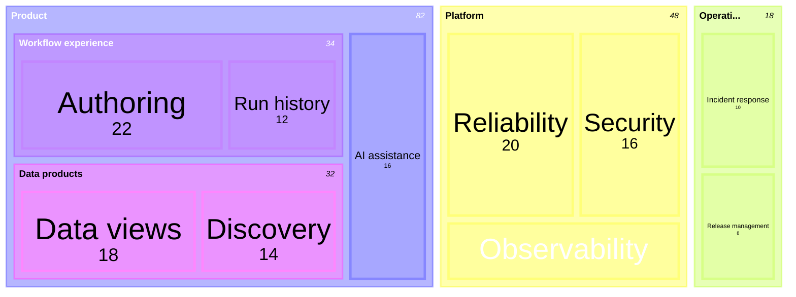

## Mermaid source

```text
treemap-beta
  "Product"
    "Workflow experience"
      "Authoring": 22
      "Run history": 12
    "Data products"
      "Discovery": 14
      "Data views": 18
    "AI assistance": 16
  "Platform"
    "Reliability": 20
    "Security": 16
    "Observability": 12
  "Operations"
    "Incident response": 10
    "Release management": 8
```

Change one line at a time, then compare the rendered result on the right.

<!-- ds-course-column:2 type=markdown -->

## Rendered result



Use zoom, fit, fullscreen, and source controls when the diagram is dense.
