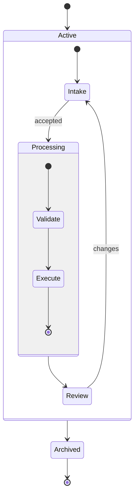

## Composite state diagram: nested lifecycles

**Atlas example 24 of 44**

Use composite states when a high-level state contains its own internal lifecycle.

### Core Mermaid elements
- state Name { ... } opens a nested state.
- Each nested block may have its own [*] start and end.
- Transitions can connect internal states or cross the parent boundary.
- Nested state blocks can be composed more than one level deep.

### Build it well
1. Model the outer lifecycle first.
2. Add internal states only where they clarify behavior.
3. Keep entry and exit paths explicit.
4. Avoid nesting so deeply that the lifecycle becomes harder to follow.

> Composite states reveal hierarchy without splitting one lifecycle across unrelated charts.

<!-- ds-course-column:2 type=markdown -->

## Working example

Use the chart controls to zoom, fit, open fullscreen, or inspect the exact source.
