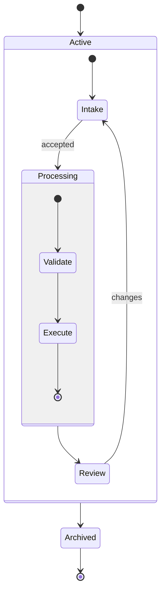

## Mermaid source

```text
stateDiagram-v2
  [*] --> Active
  state Active {
    [*] --> Intake
    Intake --> Processing: accepted
    state Processing {
      [*] --> Validate
      Validate --> Execute
      Execute --> [*]
    }
    Processing --> Review
    Review --> Intake: changes
  }
  Active --> Archived
  Archived --> [*]
```

Change one line at a time, then compare the rendered result on the right.

<!-- ds-course-column:2 type=markdown -->

## Rendered result



Use zoom, fit, fullscreen, and source controls when the diagram is dense.
