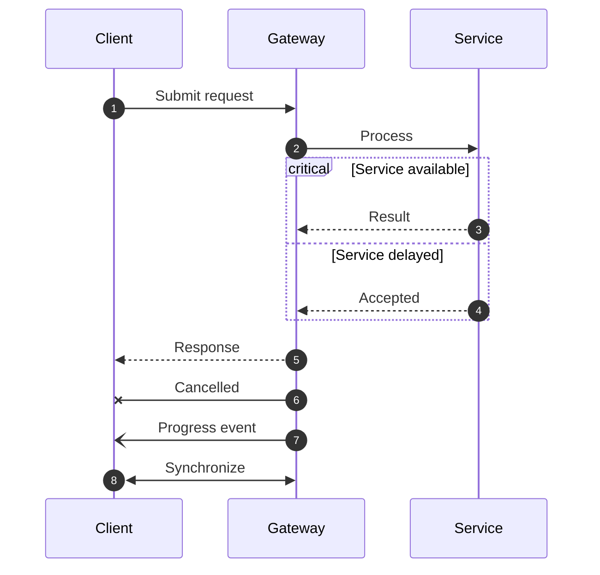

## Advanced sequence: critical paths and message variants

**Atlas example 25 of 44**

Use advanced sequence features to show critical regions, alternatives, cancellation, events, and bidirectional exchange.

### Core Mermaid elements
- critical ... option ... end groups a mandatory path and fallback.
- -x marks a lost or cancelled message; -) marks an open event arrow.
- <<->> represents a bidirectional exchange.
- autonumber keeps long interactions easy to reference.

### Build it well
1. Use fragments only when they add decision meaning.
2. Explain unusual arrow types in nearby text.
3. Keep the critical outcome visually dominant.
4. Split independent scenarios into separate diagrams.

> Advanced notation is valuable only when the audience can still follow the story.

<!-- ds-course-column:2 type=markdown -->

## Working example

Use the chart controls to zoom, fit, open fullscreen, or inspect the exact source.
