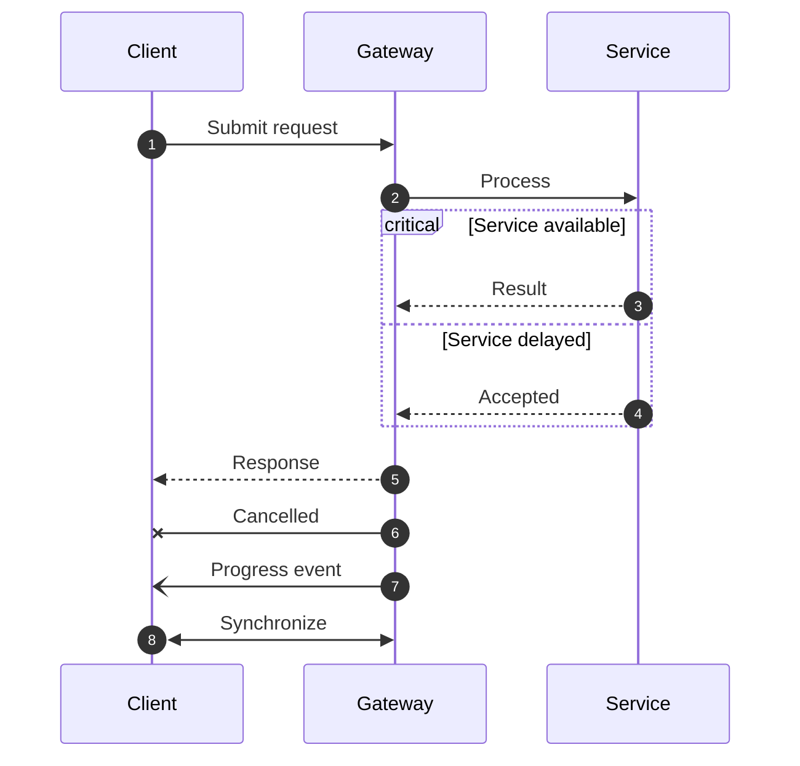

## Mermaid source

```text
sequenceDiagram
  autonumber
  participant Client
  participant Gateway
  participant Service
  Client->>Gateway: Submit request
  Gateway->>Service: Process
  critical Service available
    Service-->>Gateway: Result
  option Service delayed
    Service-->>Gateway: Accepted
  end
  Gateway-->>Client: Response
  Gateway-xClient: Cancelled
  Gateway-)Client: Progress event
  Client<<->>Gateway: Synchronize
```

Change one line at a time, then compare the rendered result on the right.

<!-- ds-course-column:2 type=markdown -->

## Rendered result



Use zoom, fit, fullscreen, and source controls when the diagram is dense.
