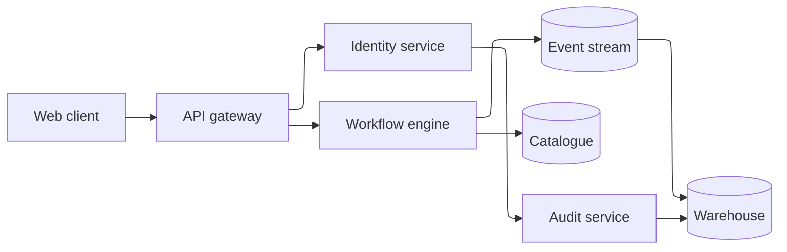

## ELK flowchart: large service topology

**Atlas example 26 of 44**

Use flowchart-elk for larger directed graphs where the ELK layout engine produces a cleaner topology. AI Commons accepts the syntax but lays it out with the same graph engine as a normal flowchart, so expect the same geometry.

### Core Mermaid elements
- flowchart-elk LR requests ELK and a left-to-right direction.
- Normal flowchart nodes and arrows still apply.
- Database shapes use [(Label)].
- AI Commons arranges nodes automatically, as for any flowchart.

### Build it well
1. Keep flowchart-elk for sources shared with ELK-enabled Mermaid tools.
2. Keep edge direction consistent.
3. Group or split unrelated subsystems.
4. Still label important relationships; layout cannot supply meaning.

> Changing the layout engine helps geometry, not an overloaded information model.

<!-- ds-course-column:2 type=markdown -->

## Working example

Use the chart controls to zoom, fit, open fullscreen, or inspect the exact source.
