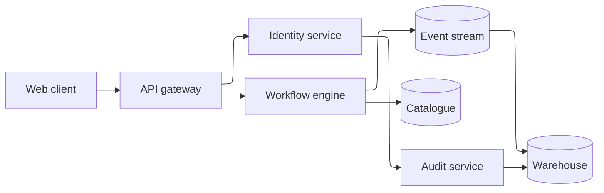

## Mermaid source

```text
flowchart-elk LR
  Client[Web client] --> Gateway[API gateway]
  Gateway --> Identity[Identity service]
  Gateway --> Workflow[Workflow engine]
  Workflow --> Events[(Event stream)]
  Workflow --> Catalogue[(Catalogue)]
  Events --> Warehouse[(Warehouse)]
  Identity --> Audit[Audit service]
  Audit --> Warehouse
```

Change one line at a time, then compare the rendered result on the right.

<!-- ds-course-column:2 type=markdown -->

## Rendered result



Use zoom, fit, fullscreen, and source controls when the diagram is dense.
