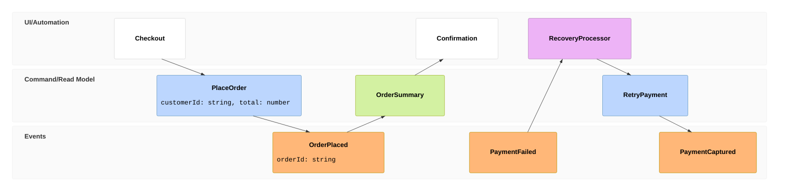

## Event modeling: commands, events, views, and processors

**Atlas example 29 of 44**

Use event modeling to describe a product flow through interfaces, commands, events, read models, and processors.

### Core Mermaid elements
- eventmodeling starts the model.
- tf creates a normal timeline item; rf marks a reverse or failure flow.
- ui, cmd, evt, rmo, and pcr select the item category.
- The numeric position orders items; braces may document a simple payload.

### Build it well
1. Start from business events.
2. Place commands immediately before the events they produce.
3. Add interfaces and read models around the behavior.
4. Show recovery paths where failures change the flow.

> Events describe facts that happened; commands describe intent.

<!-- ds-course-column:2 type=markdown -->

## Working example

Use the chart controls to zoom, fit, open fullscreen, or inspect the exact source.
