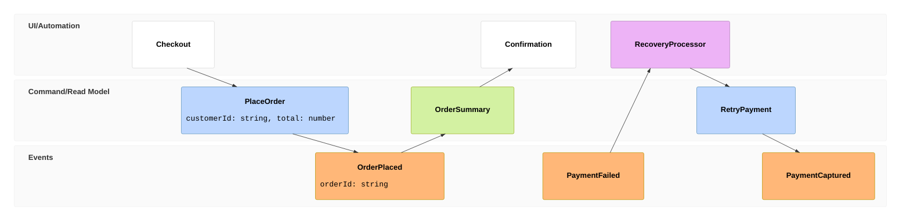

## Mermaid source

```text
eventmodeling
  tf 01 ui Checkout
  tf 02 cmd PlaceOrder { customerId: string, total: number }
  tf 03 evt OrderPlaced { orderId: string }
  tf 04 rmo OrderSummary
  tf 05 ui Confirmation
  rf 06 evt PaymentFailed
  tf 07 pcr RecoveryProcessor
  tf 08 cmd RetryPayment
  tf 09 evt PaymentCaptured
```

Change one line at a time, then compare the rendered result on the right.

<!-- ds-course-column:2 type=markdown -->

## Rendered result



Use zoom, fit, fullscreen, and source controls when the diagram is dense.
