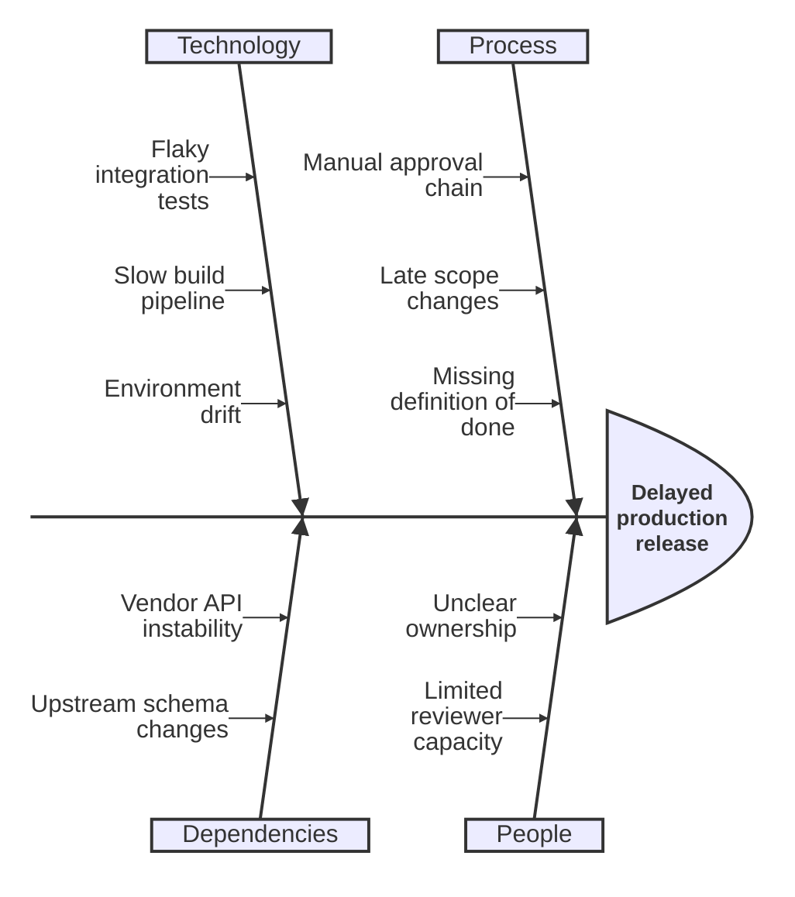

## Ishikawa diagram: categories of root causes

**Atlas example 31 of 44**

Use an Ishikawa or fishbone diagram to organize possible causes behind one observed effect.

### Core Mermaid elements
- ishikawa-beta starts the diagram.
- The first indented line after the directive is the effect.
- First-level indented labels create cause branches.
- Further indentation adds causes within each branch.

### Build it well
1. State one observable effect.
2. Choose cause categories that cover different dimensions.
3. Write causes, not solutions.
4. Validate suspected causes with evidence after brainstorming.

> The chart organizes hypotheses; it does not prove causality.

<!-- ds-course-column:2 type=markdown -->

## Working example

Use the chart controls to zoom, fit, open fullscreen, or inspect the exact source.
