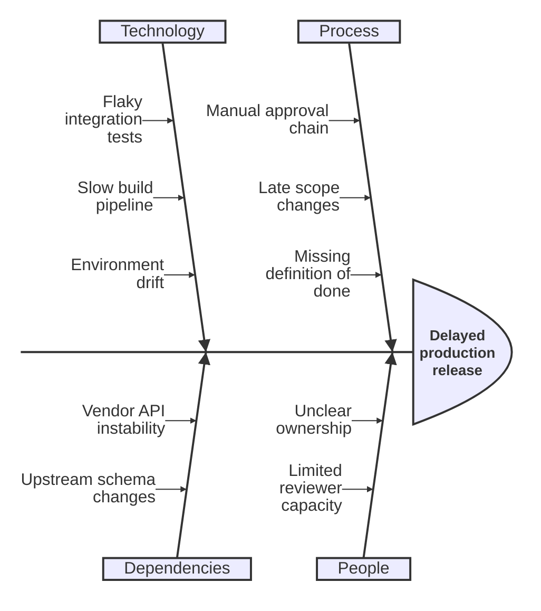

## Mermaid source

```text
ishikawa-beta
  Delayed production release
    Process
      Manual approval chain
      Late scope changes
      Missing definition of done
    People
      Unclear ownership
      Limited reviewer capacity
    Technology
      Flaky integration tests
      Slow build pipeline
      Environment drift
    Dependencies
      Vendor API instability
      Upstream schema changes
```

Change one line at a time, then compare the rendered result on the right.

<!-- ds-course-column:2 type=markdown -->

## Rendered result



Use zoom, fit, fullscreen, and source controls when the diagram is dense.
