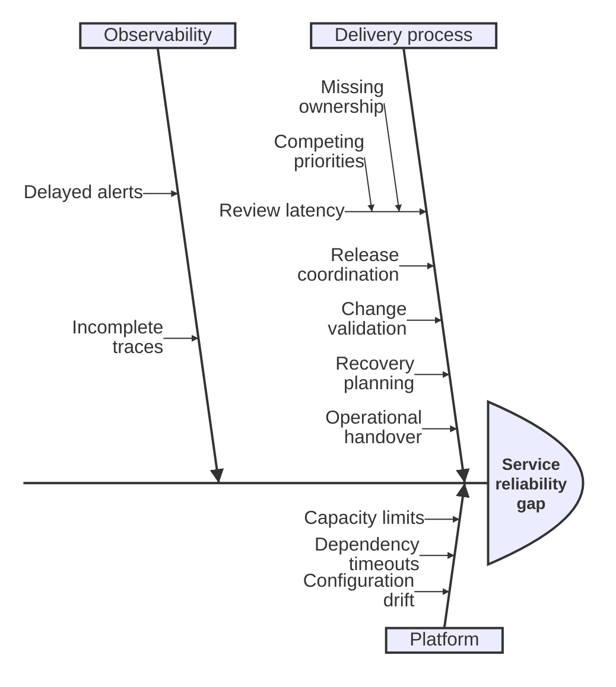

## Deep Ishikawa: multi-level cause analysis

**Atlas example 32 of 44**

Use deeper Ishikawa nesting when a broad cause contains several layers of contributing conditions.

### Core Mermaid elements
- The effect and first-level branches follow normal ishikawa-beta syntax.
- Additional indentation creates sub-causes beneath a cause.
- Each indentation level should answer why the parent condition exists.
- The renderer keeps the nested hierarchy attached to its branch.

### Build it well
1. Start broad, then ask why repeatedly.
2. Stop nesting when evidence can be collected.
3. Keep sibling causes at comparable depth.
4. Do not mix corrective actions into the cause tree.

> More depth is useful only when every level adds a distinct causal hypothesis.

<!-- ds-course-column:2 type=markdown -->

## Working example

Use the chart controls to zoom, fit, open fullscreen, or inspect the exact source.
