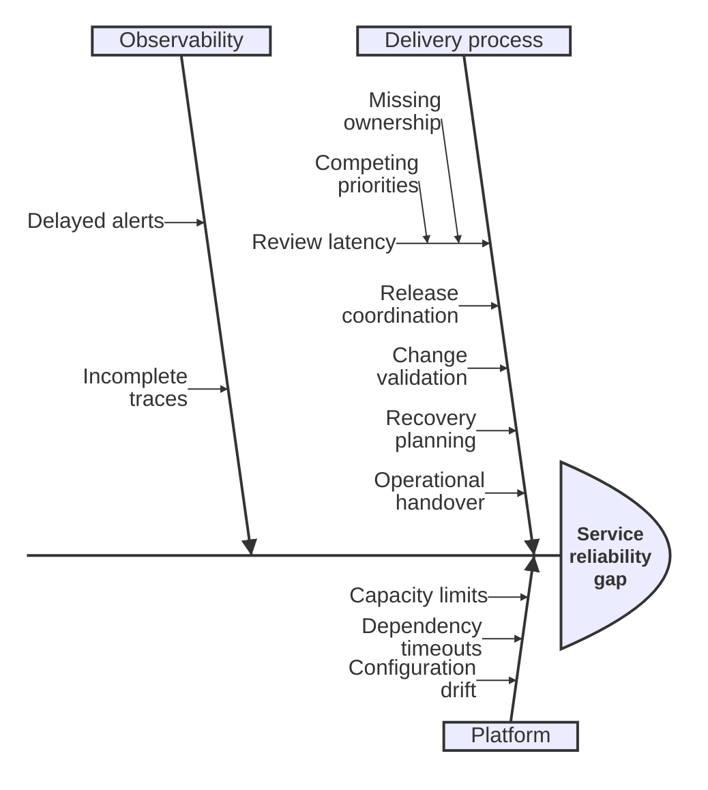

## Mermaid source

```text
ishikawa-beta
  Service reliability gap
    Delivery process
      Review latency
        Missing ownership
        Competing priorities
      Release coordination
      Change validation
      Recovery planning
      Operational handover
    Platform
      Capacity limits
      Dependency timeouts
      Configuration drift
    Observability
      Delayed alerts
      Incomplete traces
```

Change one line at a time, then compare the rendered result on the right.

<!-- ds-course-column:2 type=markdown -->

## Rendered result



Use zoom, fit, fullscreen, and source controls when the diagram is dense.
