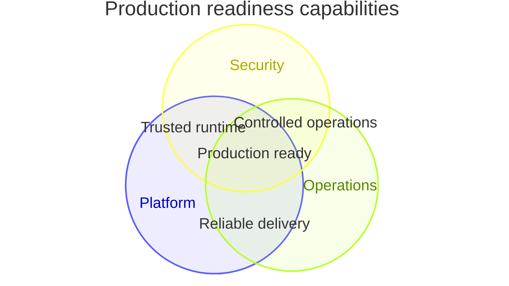

## Venn diagram: three-set overlap

**Atlas example 33 of 44**

Use a Venn diagram to show shared and unique capability across a small number of sets.

### Core Mermaid elements
- venn-beta starts the diagram; title provides context.
- set Id["Label"]: value declares a set and its size.
- union A,B["Label"]: value declares an overlap.
- A three-way union lists all three ids.

### Build it well
1. Use sets with a clear common universe.
2. Keep values internally plausible.
3. Name intersections by their combined meaning.
4. Use another chart when there are many sets or precise comparison matters.

> Venn emphasizes overlap, not hierarchy or process.

<!-- ds-course-column:2 type=markdown -->

## Working example

Use the chart controls to zoom, fit, open fullscreen, or inspect the exact source.
