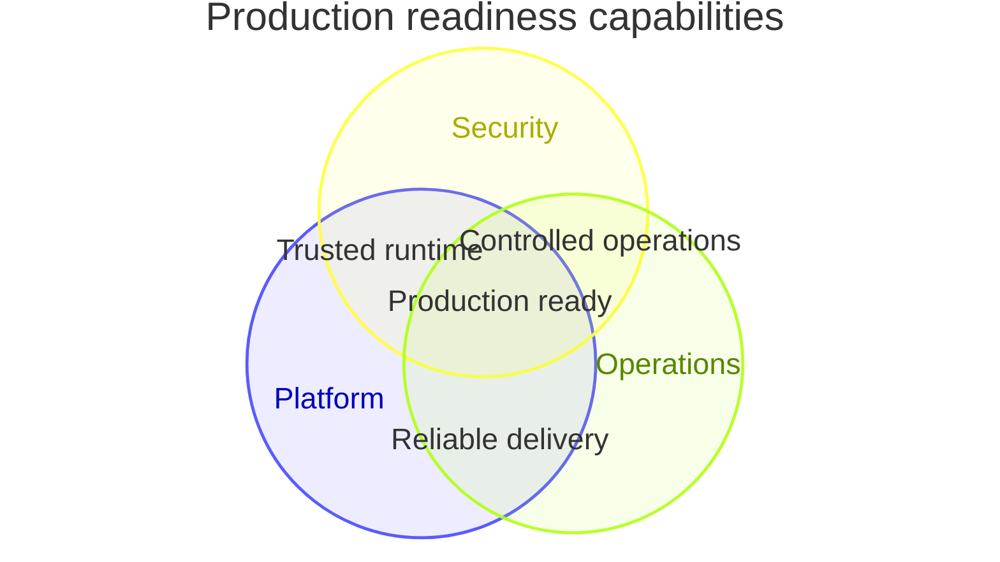

## Mermaid source

```text
venn-beta
  title Production readiness capabilities
  set Platform["Platform"]: 90
  set Security["Security"]: 80
  set Operations["Operations"]: 85
  union Platform,Security["Trusted runtime"]: 35
  union Platform,Operations["Reliable delivery"]: 40
  union Security,Operations["Controlled operations"]: 30
  union Platform,Security,Operations["Production ready"]: 20
```

Change one line at a time, then compare the rendered result on the right.

<!-- ds-course-column:2 type=markdown -->

## Rendered result



Use zoom, fit, fullscreen, and source controls when the diagram is dense.
