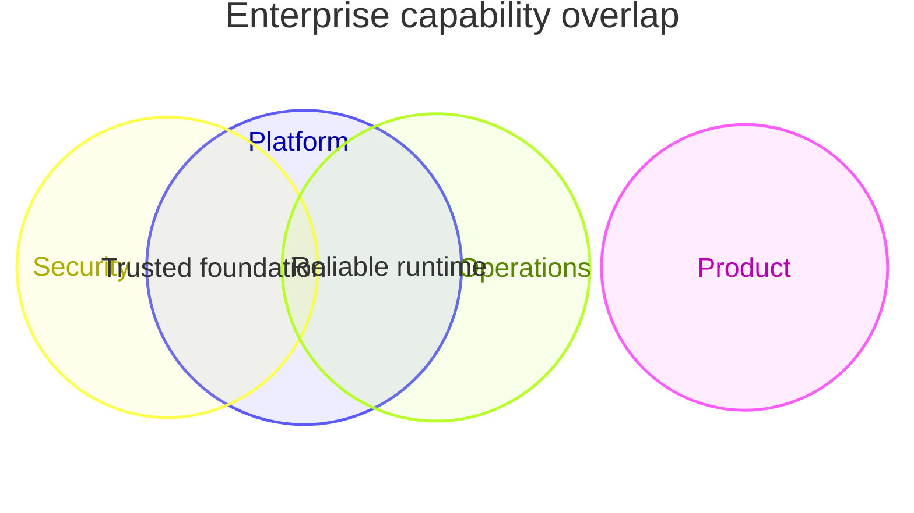

## Venn diagram: four-set capability model

**Atlas example 34 of 44**

Use a four-set Venn only when the combined intersection is central to the message and the audience can handle the added complexity.

### Core Mermaid elements
- Declare four set entries with unique ids.
- Pairwise, three-way, and four-way unions list the participating ids.
- Every intersection may have its own label and value.
- Source order helps keep the specification readable.

### Build it well
1. Show only intersections that support the decision.
2. Explain the meaning of the central overlap.
3. Avoid inventing values merely to fill every region.
4. Prefer a matrix if readers must compare many combinations.

> Four sets are near the practical readability limit for a Venn diagram.

<!-- ds-course-column:2 type=markdown -->

## Working example

Use the chart controls to zoom, fit, open fullscreen, or inspect the exact source.
