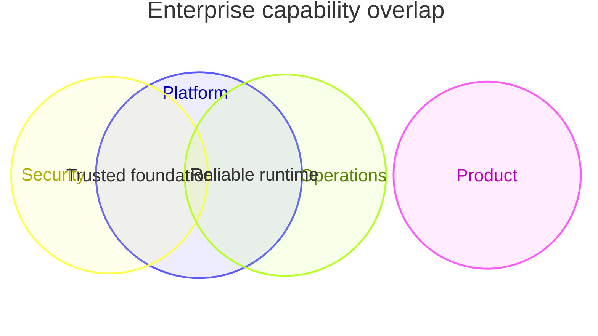

## Mermaid source

```text
venn-beta
  title Enterprise capability overlap
  set Platform["Platform"]: 92
  set Security["Security"]: 84
  set Operations["Operations"]: 88
  set Product["Product"]: 76
  union Platform,Security["Trusted foundation"]: 42
  union Platform,Operations["Reliable runtime"]: 45
  union Security,Operations,Product["Governed delivery"]: 24
  union Platform,Security,Operations,Product["Enterprise ready"]: 15
```

Change one line at a time, then compare the rendered result on the right.

<!-- ds-course-column:2 type=markdown -->

## Rendered result



Use zoom, fit, fullscreen, and source controls when the diagram is dense.
