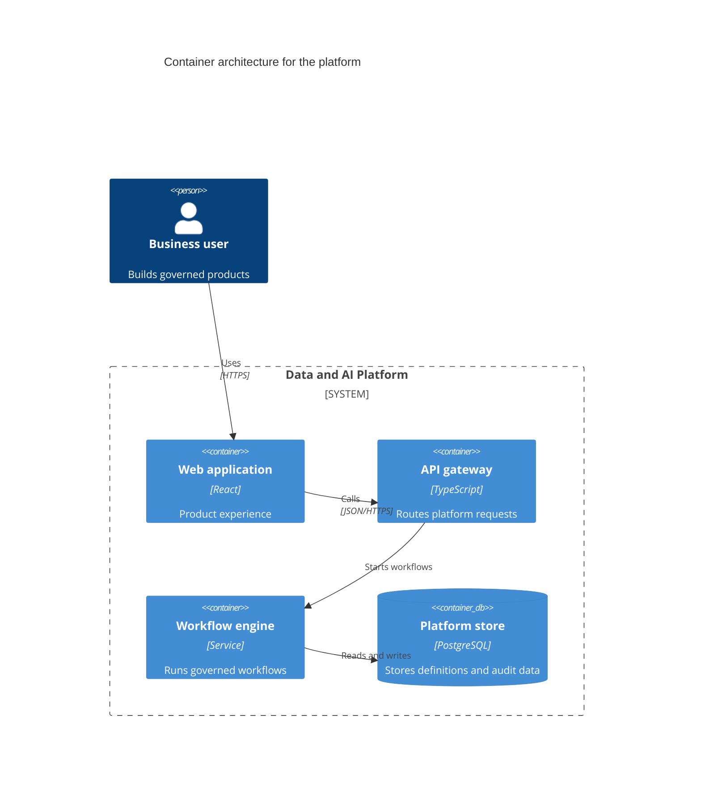

## C4 container: applications and data stores

**Atlas example 41 of 44**

Use a C4 container diagram to show the major deployable applications, services, and data stores inside a system.

### Core Mermaid elements
- C4Container selects level two.
- System_Boundary groups the containers in scope.
- Container and ContainerDb declare deployable units with technology and responsibility.
- Rel connects people and containers; a fourth argument can name the protocol.

### Build it well
1. Show deployable or runnable boundaries, not classes.
2. State each container’s responsibility.
3. Include technology only when it informs a decision.
4. Keep external actors and systems visible for context.

> A container is a deployable responsibility boundary, not necessarily an operating-system container.

<!-- ds-course-column:2 type=markdown -->

## Working example

Use the chart controls to zoom, fit, open fullscreen, or inspect the exact source.
