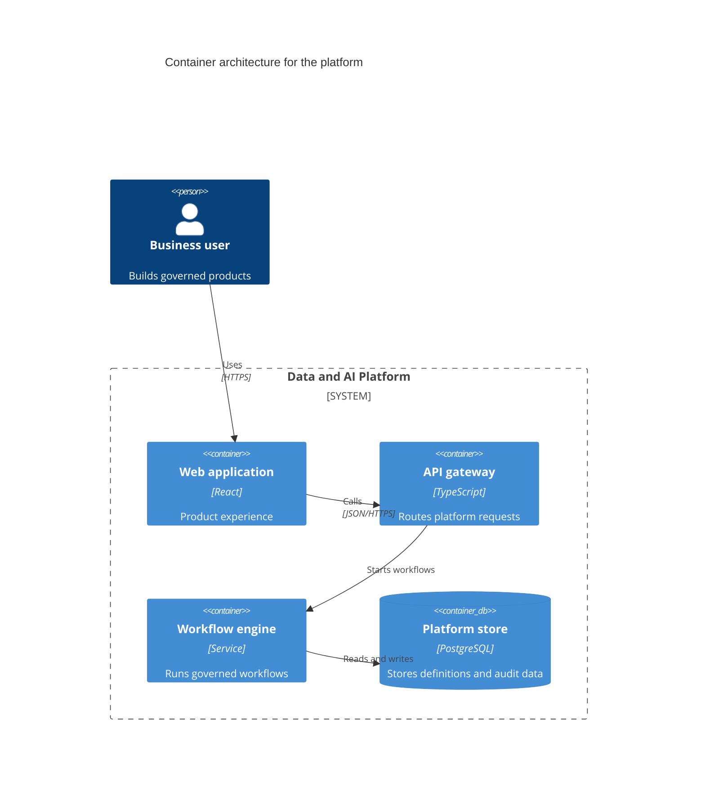

## Mermaid source

```text
C4Container
  title Container architecture for the platform
  Person(user, "Business user", "Builds governed products")
  System_Boundary(platform, "Data and AI Platform") {
    Container(web, "Web application", "React", "Product experience")
    Container(api, "API gateway", "TypeScript", "Routes platform requests")
    Container(workflow, "Workflow engine", "Service", "Runs governed workflows")
    ContainerDb(store, "Platform store", "PostgreSQL", "Stores definitions and audit data")
  }
  Rel(user, web, "Uses", "HTTPS")
  Rel(web, api, "Calls", "JSON/HTTPS")
  Rel(api, workflow, "Starts workflows")
  Rel(workflow, store, "Reads and writes")
```

Change one line at a time, then compare the rendered result on the right.

<!-- ds-course-column:2 type=markdown -->

## Rendered result



Use zoom, fit, fullscreen, and source controls when the diagram is dense.
