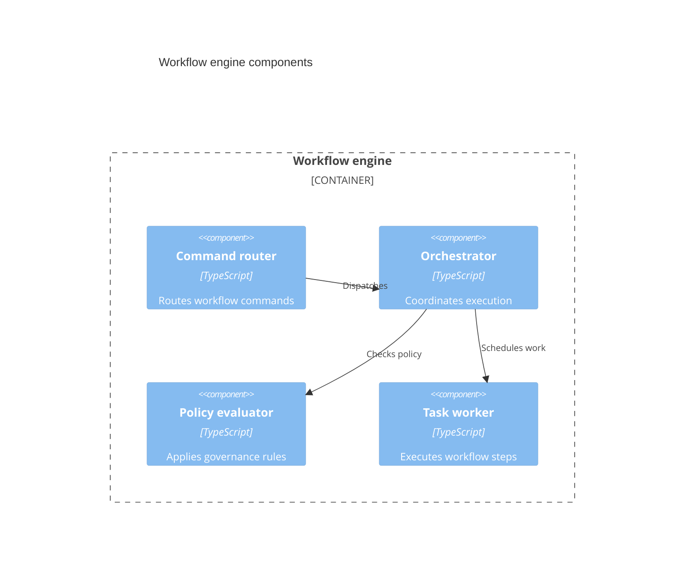

## C4 component: responsibilities inside a container

**Atlas example 42 of 44**

Use a C4 component diagram to explain the major cooperating parts inside one container.

### Core Mermaid elements
- C4Component selects level three.
- Container_Boundary names the container being decomposed.
- Component declares a responsibility, technology, and description.
- Rel describes collaboration between components.

### Build it well
1. Decompose only one container per diagram.
2. Name components by responsibility.
3. Show the relationships that explain a use case.
4. Avoid listing every module or utility.

> Components should clarify architecture, not reproduce the folder tree.

<!-- ds-course-column:2 type=markdown -->

## Working example

Use the chart controls to zoom, fit, open fullscreen, or inspect the exact source.
