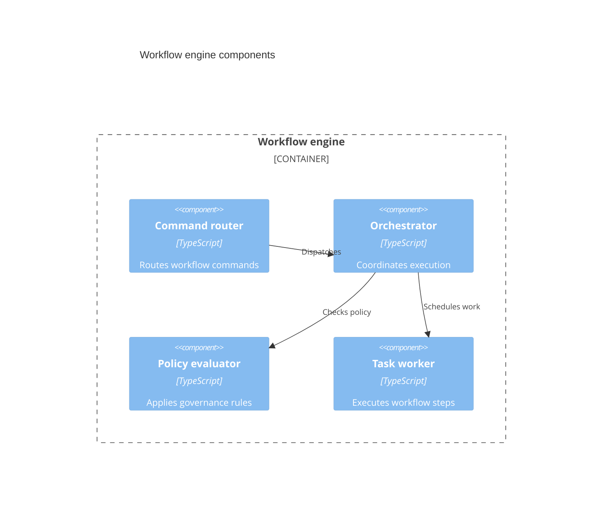

## Mermaid source

```text
C4Component
  title Workflow engine components
  Container_Boundary(engine, "Workflow engine") {
    Component(router, "Command router", "TypeScript", "Routes workflow commands")
    Component(orchestrator, "Orchestrator", "TypeScript", "Coordinates execution")
    Component(policy, "Policy evaluator", "TypeScript", "Applies governance rules")
    Component(worker, "Task worker", "TypeScript", "Executes workflow steps")
  }
  Rel(router, orchestrator, "Dispatches")
  Rel(orchestrator, policy, "Checks policy")
  Rel(orchestrator, worker, "Schedules work")
```

Change one line at a time, then compare the rendered result on the right.

<!-- ds-course-column:2 type=markdown -->

## Rendered result



Use zoom, fit, fullscreen, and source controls when the diagram is dense.
