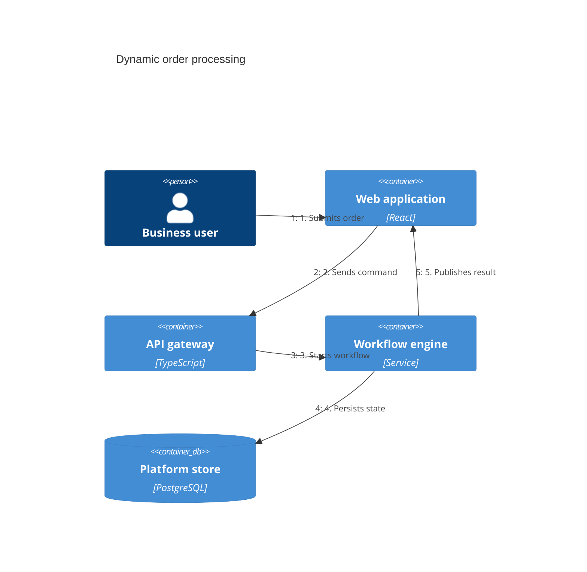

## C4 dynamic: one runtime scenario

**Atlas example 43 of 44**

Use a C4 dynamic diagram to overlay an ordered interaction on recognizable C4 elements.

### Core Mermaid elements
- C4Dynamic selects the dynamic view.
- Person, Container, and ContainerDb declare participants.
- Rel statements describe runtime interactions.
- Numbered relationship labels make execution order explicit.

### Build it well
1. Choose one scenario.
2. Number every interaction consistently.
3. Keep static structure minimal.
4. Finish with the visible business outcome.

> Dynamic C4 is a sequence story grounded in architectural boundaries.

<!-- ds-course-column:2 type=markdown -->

## Working example

Use the chart controls to zoom, fit, open fullscreen, or inspect the exact source.
