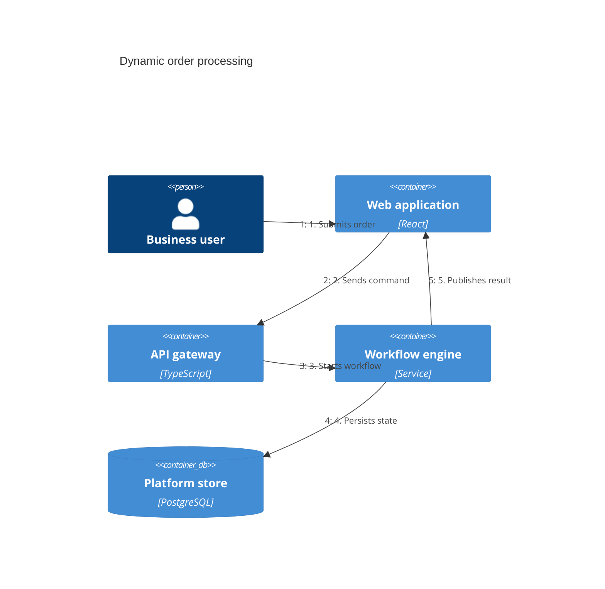

## Mermaid source

```text
C4Dynamic
  title Dynamic order processing
  Person(user, "Business user")
  Container(web, "Web application", "React")
  Container(api, "API gateway", "TypeScript")
  Container(workflow, "Workflow engine", "Service")
  ContainerDb(store, "Platform store", "PostgreSQL")
  Rel(user, web, "1. Submits order")
  Rel(web, api, "2. Sends command")
  Rel(api, workflow, "3. Starts workflow")
  Rel(workflow, store, "4. Persists state")
  Rel(workflow, web, "5. Publishes result")
```

Change one line at a time, then compare the rendered result on the right.

<!-- ds-course-column:2 type=markdown -->

## Rendered result



Use zoom, fit, fullscreen, and source controls when the diagram is dense.
