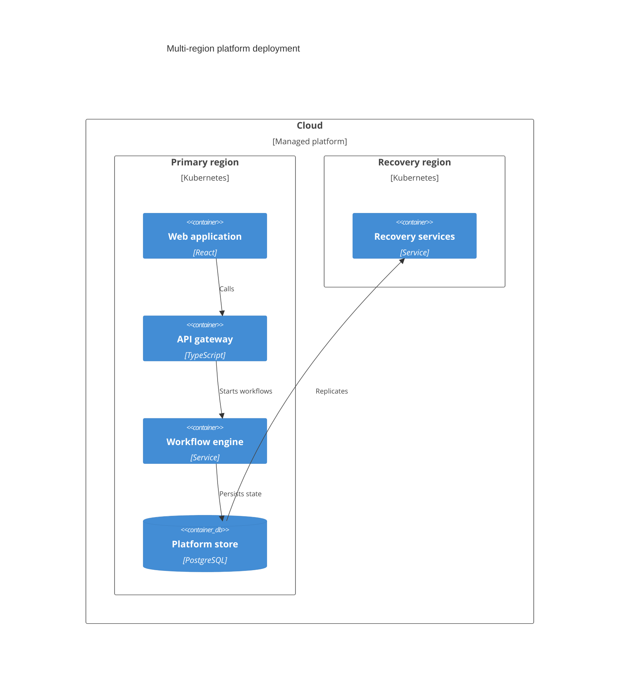

## C4 deployment: infrastructure and placement

**Atlas example 44 of 44**

Use a C4 deployment diagram to show where containers run across environments, regions, nodes, and recovery locations.

### Core Mermaid elements
- C4Deployment selects the deployment view.
- Deployment_Node creates nested infrastructure boundaries.
- Container and ContainerDb place software inside nodes.
- Rel describes runtime or replication connections across placements.

### Build it well
1. Nest nodes from broad environment to concrete runtime.
2. Show primary and recovery placement clearly.
3. Label cross-region relationships.
4. Avoid mixing logical components that do not affect deployment.

> Deployment diagrams answer where software runs and how locations connect.

<!-- ds-course-column:2 type=markdown -->

## Working example

Use the chart controls to zoom, fit, open fullscreen, or inspect the exact source.
