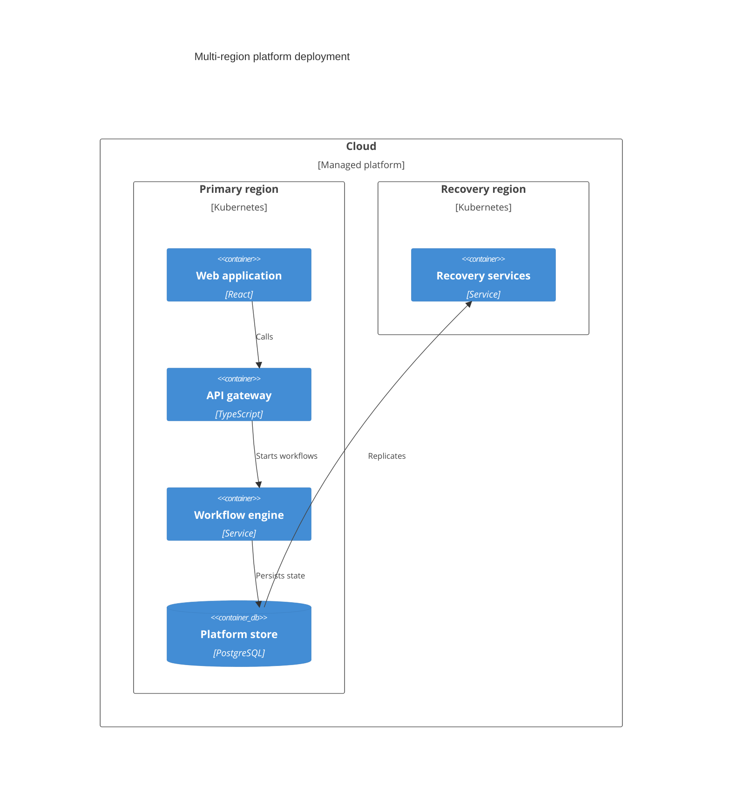

## Mermaid source

```text
C4Deployment
  title Multi-region platform deployment
  Deployment_Node(cloud, "Cloud", "Managed platform") {
    Deployment_Node(primary, "Primary region", "Kubernetes") {
      Container(web, "Web application", "React")
      Container(api, "API gateway", "TypeScript")
      Container(workflow, "Workflow engine", "Service")
      ContainerDb(store, "Platform store", "PostgreSQL")
    }
    Deployment_Node(secondary, "Recovery region", "Kubernetes") {
      Container(recovery, "Recovery services", "Service")
    }
  }
  Rel(web, api, "Calls")
  Rel(api, workflow, "Starts workflows")
  Rel(workflow, store, "Persists state")
  Rel(store, recovery, "Replicates")
```

Change one line at a time, then compare the rendered result on the right.

<!-- ds-course-column:2 type=markdown -->

## Rendered result



Use zoom, fit, fullscreen, and source controls when the diagram is dense.
