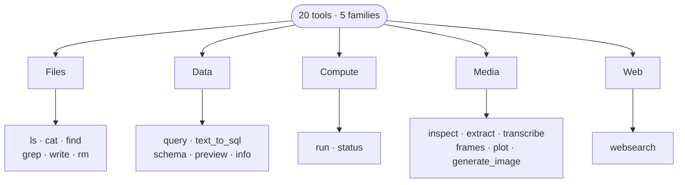

## Twenty tools, five families. Learn the families, not the list.

Commons offers a small, deliberately named catalogue instead of hundreds of one-off features — which means **you can ask for things precisely without being technical.**

| Family | What it's for | Tools |
|---|---|---|
| **Files** | Find, read, change and remove what already exists | `ls` · `cat` · `find` · `grep` · `write` · `rm` |
| **Data** | Understand datasets and compute answers from them | `query` · `text_to_sql` · `schema` · `preview` · `info` |
| **Compute** | Fire jobs and follow them | `run` · `status` |
| **Media** | Read and make images, documents, audio and video | `inspect` · `extract` · `transcribe` · `frames` · `plot` · `generate_image` |
| **Web** | Reach the outside world | `websearch` |

> Some actions **pause for a human** rather than acting immediately — by default `write`, `rm` and `run` ask you to confirm, and the most sensitive ones wait for a named approver to `approve` or `reject`

Notice that sign-off. It is built into the platform, not bolted on afterwards — often the detail that wins over a cautious stakeholder.

<!-- ds-course-column:2 type=markdown -->

